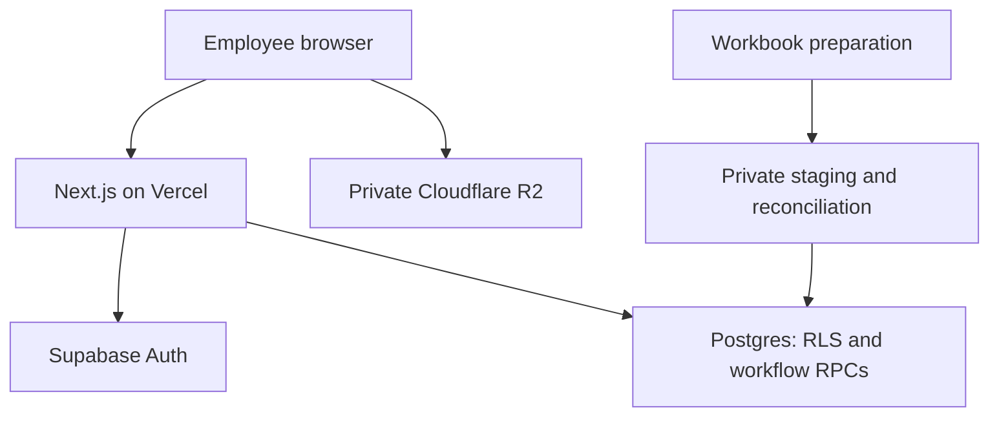

# Architecture and MVP boundaries

## Business outcome

Sales can quickly find a property, identify a valid contact, inspect its characteristics and documents, and request a reservation when a deal is agreed. Independent review prevents incorrect commission-attribution claims. Management can inspect inventory by area, employee activity by Vietnam day, rental occupancy per month and confirmed rent balances.

## Components

The browser reaches the private bucket directly and the database never touches file bytes: authorization runs through registered file metadata. The RLS-checked `property_files` record is authorized first, so the short-lived presigned URL is minted only afterwards, and completion attests the exact object bytes under a signature the database verifies.

| Component | Responsibility | Exclusions |
| --- | --- | --- |
| Next.js | Responsive Vietnamese/English UI, SSR, validated forms, server actions, request-scoped Supabase clients | Commission computation and direct privileged user-data queries |
| Supabase Auth | Invitations, authentication, recovery, sessions | Business roles derived from user-editable metadata |
| Postgres | Inventory, addresses, relationships, activity, approvals, audit, analytic views | Binary files, commission payouts and general accounting |
| Cloudflare R2 | Private photos, certificates and supporting evidence, reached only through short-lived presigned URLs | Public legal-file URLs and overwrite-in-place |
| Vercel | Next.js build, preview and production hosting | Database migration authority and scheduled financial jobs |
| Import tools | Profiling, normalization, reviewed mappings, controlled promotion | Guessing unmatched references or inventing current wards |

## User screens

1. Login/invitation and account recovery.
2. Inventory: search both addresses, mode, type, access, price, area, status; 30 rows/page, maximum 50.
3. Property detail: old/current address badges, characteristics, owner/broker contacts, private documents, effective reservation and request action.
4. My activity: page views, unique properties viewed and owner-contact properties per Vietnam day.
5. My reservations: pending, approved, rejected, released and expired requests.
6. Review queue (manager/admin): requests, evidence, claimant, dates and decision reasons.
7. Administration: employees and roles, inventory by verified current area/legacy district, effective locks by employee, unresolved address records.

## Architecture decisions

| Decision | Reason and tradeoff |
| --- | --- |
| One company / company-wide manager authority | Simplifies RLS and UI for 17 source employees; team restrictions would require a new authorization design |
| Next.js monolith | Avoids a separate Python/API hosting service; Postgres handles atomic decisions |
| Public business schema + private internal schema | Uses standard Supabase clients while keeping staging/audit out of the Data API |
| Normalized contacts and address rows | Supports multiple contacts and historical/new addresses without column duplication |
| Live employee authorization | Deactivation and role changes affect subsequent DB requests without waiting for JWT role refresh |
| Private storage and immutable paths | Legal files remain internal; replacement means a new metadata record and object path |
| PostgreSQL search first | Accent-normalized trigram search fits ~19k records; short numeric queries can need more work than long words |
| UUID-ordered browsing | Stable, bounded retrieval; initial order is UUID, not newest-first. The inventory list pages by offset with a matching count from one filtered read (issue #140), and its chronological order uses `(entry_on,id)` and never converts `created_at` into an entry date ([schema.md](schema.md)) |
| Independent approval | Prevents unilateral reservation claims; requires at least two active reviewers for reviewer-owned deals |
| VND integer numeric, rent dues/receipts but no commission ledger | Supports inventory prices and rental month balances; commission remains attribution-only |

## Hosting and environments

Use two logical stages, `dev` and `prod`, with a separate Supabase project and isolated Vercel project per stage. Both host the same Next.js application; local development and PR previews use dev credentials and sanitized fixtures only. GitHub environment-gated workflows publish PR previews and stage releases after per-stage activation (`CD_PREVIEW_ENABLED`, `CD_DEV_ENABLED`, `CD_PROD_ENABLED`; each off by default and unable to start another stage's run); native Vercel Git deployments remain disabled. Production pushes verify schema readiness without applying migrations; database writes remain explicitly authorized. The isolated hosting projects also prevent Vercel's first-deployment Production behavior from selecting production data for dev. Set regions near users after checking availability. Local/CI Node is pinned to `24.14.0`; Vercel uses `24.x`. See [setup.md](setup.md) and [development.md](development.md).

Set Auth site URL and exact allowed callback URLs per environment. Disable public and anonymous signup; invite users through an admin-only server operation. A privileged server key is only needed for Auth administration and must not be the default inventory data client.

## Material limitations

Address catalogs and file bytes are missing from the workbook package. There are unresolved references and duplicated property IDs. Property classifications mix physical type and alley access. Historical clicks do not prove visits. Legal review labels are internal workflow labels, not proof of title. These limitations must remain visible during migration and use.
