# Database schema

The executable SQL in `supabase/migrations/` defines every column, default, check, foreign key, index, policy and function. This document describes the logical model; `database-contract.md` defines client access.

## Relationship model

```mermaid
erDiagram
  PROPERTIES ||--o{ PROPERTY_ADDRESSES : has
  ADMIN_UNIT_VERSIONS ||--o{ PROPERTY_ADDRESSES : identifies
  ADMIN_UNIT_VERSIONS ||--o{ ADMIN_UNIT_CROSSWALKS : transitions
  PROPERTIES ||--o{ PROPERTY_CONTACTS : links
  CONTACTS ||--o{ PROPERTY_CONTACTS : supplies
  PROPERTIES ||--o{ PROPERTY_FILES : documents
  DOCUMENT_CATEGORIES ||--o{ PROPERTY_FILES : classifies
  PROPERTY_FILES |o--o| PROPERTIES : chosen_cover
  PROPERTIES ||--o{ PROPERTY_LOCKS : reserves
  EMPLOYEES ||--o{ PROPERTY_LOCKS : claims
  PROPERTY_LOCKS ||--o{ LOCK_EVENTS : records
  EMPLOYEES ||--o{ ACTIVITY_EVENTS : performs
  PROPERTIES ||--o{ ACTIVITY_EVENTS : concerns
  PROPERTIES ||--o{ PROPERTY_HISTORY : records
  EMPLOYEES ||--o{ PROPERTY_HISTORY : performs
  PROPERTIES ||--o{ CORRECTION_REQUESTS : concerns
  EMPLOYEES ||--o{ CORRECTION_REQUESTS : requests
  CORRECTION_REQUESTS ||--o{ CORRECTION_AMENDMENTS : amends
  PROPERTIES ||--o{ PROPERTY_COMMENTS : discusses
  EMPLOYEES ||--o{ PROPERTY_COMMENTS : posts
  PROPERTY_COMMENTS ||--o| PROPERTY_COMMENT_REMOVALS : retains
  EMPLOYEES ||--o{ PROPERTY_COMMENT_REMOVALS : removes
  PROPERTY_COMMENTS ||--o{ PROPERTY_COMMENT_REVISIONS : retains
  PROPERTIES ||--o{ PROPERTY_COMMENT_REVISIONS : concerns
  EMPLOYEES ||--o{ PROPERTY_COMMENT_REVISIONS : edits
```

## Business tables

| Table | Key fields and purpose | Important invariants |
| --- | --- | --- |
| `employees` | UUID `id`, optional unique `auth_user_id`, unique normalized email, name, phone, role, active flag | Active requires linked Auth user; only admin manages roles/activation; source employees start inactive |
| `properties` | UUID, unique `property_code`, mode, physical type, access type, status/review state, dimensions, direction, VND prices, legal state, parcel/map sheet, notes, coordinates, creator/updater/time/archive, nullable explicit cover file | UUID is permanent identity; amounts nonnegative; areas/dimensions positive; coordinates both present or absent; final/review states require reviewer; only a current editor chooses/clears a technically completed same-property photo, never an automatic first image |
| `property_addresses` | Property FK, legacy/current/alternate, original full text, house/street/raw unit labels, version FKs, mapping/verification metadata, primary flag, normalized search text | One primary per property and format; current has no district; verified requires provenance/reviewer and valid unit hierarchy/date |
| `admin_unit_versions` | Official code as text, Vietnamese name, level, parent version, half-open validity dates, source URL | Codes preserve leading zeros; parent/version lineage checked at address verification; catalog ingestion must validate overlapping versions and parent intervals |
| `admin_unit_crosswalks` | From/to version FKs, whole/partial/rename, effective date, source, notes, reviewer | Crosswalks do not directly set a property's address; partial transitions require boundary or property-level evidence |
| `contacts` | UUID, name, normalized phone string array, untouched raw phone text, role and notes | No global merges based on generic owner name or masked phone ID |
| `property_contacts` | Composite property/contact PK, relation, primary flag | Supports several owners/brokers; at most one primary contact per property |
| `property_history` | UUID, property/actor FKs, actor name snapshot, `occurred_at`, target and target ID, changed fields, before/after JSON, optional correction explanation | No direct client DML; written in the same transaction as the change; only changed allowlisted business fields, with numeric values as decimal strings |
| `correction_requests` | UUID, property/requester FKs, target and target ID, category, explanation, proposed/observed JSON, revision, `open`/`applied`/`rejected`/`withdrawn`, decision attribution | No direct client DML; the original observed state and proposal are immutable; terminal requests cannot be reapplied |
| `correction_amendments` | UUID, request/requester FKs, explanation, proposed/observed JSON, revision, created time | Append-only; preserves the original submission instead of rewriting it |
| `property_files` | UUID, property FK, historical legacy type, one category FK, independent document/photo purpose, private bucket, immutable object path/name/MIME/count/hash/uploader, upload state, paired technical-validation time/object identity, historical review attribution | No direct authenticated metadata writes; registration and attested completion preserve identity; ready files are shared privately without human review; pending recovery remains uploader-only on unarchived parents; only uploader/current editor corrects category, without changing content or readiness |
| `document_categories` | UUID, trimmed accented name, optional known builtin marker, nullable creator and creation time | Active employees read/create-or-reuse company categories; normalized case/Unicode-edge uniqueness preserves accents; Other is the localized default; custom names remain verbatim; no rename/delete/merge/multiple tags |
| `activity_events` | UUID, employee/property FK, page_view/owner_contact_access/site_visit, occurred/recorded timestamps, generated Vietnam day, source, idempotency key, retained visit decision | No direct client DML; one key per employee; owner-contact access counts one distinct property per employee/Vietnam day; new `site_visit` submission and confirmation are retired while retained rows keep their state; page_view and owner_contact_access have no visit status |
| `property_locks` | UUID, property/claimant, reason, optional evidence, attribution reference, lifecycle state, expiry, independent decision | One approved row per property; one pending request per property/employee; effective reservation additionally requires future expiry |
| `lock_events` | Identity key, lock FK, actor, action, reason, timestamp | Append-only client access; all approved/rejected/released/expired transitions retain trace |
| `property_comments` | UUID, property/author FKs, author display name retained at posting time, current text (null once removed), server posting time, `revision`, `removed_at`, nullable latest-edit `edited_at`, employee-scoped `idempotency_key` | No direct client writes: `select`-only grant, `anon` excluded, and a trigger rejects client inserts, ordinary updates and every delete; text is trimmed Unicode of 1–2000 characters; an author edit changes only text, revision and the edited marker and a one-way removal withdraws the text, so identity, Property, posting time and position stay immutable; text is null exactly when `removed_at` is set |
| `property_comment_revisions` | Identity sequence, comment/property/actor FKs, actor name retained at edit time, edit time, before/after revision and before/after text | Append-only retained evidence with no client DML at all; readable only by an active manager/admin with current Property access, never by ordinary readers or the ordinary author |
| `property_comment_removals` | One row per removed comment: comment/property/author FKs, retained author name, retained original text, original posting time and revision, removing actor and retained actor name, removal time, `author`/`moderation` kind and mandatory moderation reason | Reviewer-only `select` under RLS; no client insert/update/delete; the guard trigger keeps the retained evidence immutable and non-expiring; the current discussion projection never exposes it |

`properties`, `property_addresses`, `contacts` and `property_contacts` each carry a `revision` UUID that guards stale maintenance saves. Issue #7's maintenance RPCs, correction lifecycle and history rules are in [maintenance-contract.md](maintenance-contract.md).

## Rental tables (migration 4)

| Table | Purpose and constraints |
| --- | --- |
| `rental_agreements` | Property/tenant, unique contract reference, document language, draft/active/ended/canceled, inclusive term, whole-VND agreed rent, due day, proration, independent activation and close metadata; one active whole-property agreement |
| `rental_months` | One row per agreement/calendar month, occupied date range, due date and snapshot due amount; open/voided; generated only on activation |
| `rental_payments` | Positive whole-VND receipt/refund, method/date/reference/evidence, pending/confirmed/rejected/voided, employee-scoped retry key and independent review |

`employees.preferred_locale` is `vi` or `en`, default `vi`. Contact types/links also accept `tenant`. Rental month and payment data are readable by staff/managers/admin; all active employees can read tenancy/occupancy summaries. All rental writes use guarded RPCs. See `rental-localization-contract.md` for exact lifecycle, month and payment rules.

## Private migration and audit tables

| Table | Purpose |
| --- | --- |
| `private.audit_events` | Before/after snapshots for operational changes, authenticated actor ID and server time; never directly readable by the app |
| `private.import_batches` | One source checksum per batch; staged/reviewed/promoted/failed state |
| `private.staging_rows` | Source sheet/physical row, original sanitized payload, issues and disposition; composite key supports reruns |
| `private.property_source_map` | Reviewed source key → canonical property UUID; ambiguous keys require row-specific keys |
| `private.import_entity_map` | Source row → destination entity UUID for properties/contacts/files/activity; prevents rerun duplication |
| `private.file_validation_keys` | Owner-installed per-stage singleton HMAC secret; no client, anonymous or service-role table access |

Rental agreements, monthly dues and manual receipt/refund tracking are included. There is no commission-rate, commission-payout, general accounting ledger or payment-gateway integration. `attribution_reference` is a nonfinancial business reference; the claimant comes from `requested_by`.

## Controlled values and units

| Field | Values / unit |
| --- | --- |
| Employee role | `sales`, `staff`, `manager`, `admin` |
| Listing mode | `sale`, `rent`, `both` |
| Property type | `house`, `land`, `apartment`, `villa`, `serviced_apartment`, `unclassified` |
| Access type | `street_front`, `car_alley`, `motorbike_alley`, `three_wheeler_alley`, `unknown` |
| Inventory status | `draft`, `available`, `negotiating`, `sold`, `rented`, `withdrawn` |
| Record review | `pending`, `approved`, `rejected` — independent from reservation approval |
| Legal status | `unknown`, `owner_reported`, `documents_received`, `reviewed`, `issue_flagged` |
| Address mapping | `unresolved`, `candidate`, `verified` |
| Reservation state | `pending`, `approved`, `rejected`, `released`, `expired` |
| Direction | `N`, `NE`, `E`, `SE`, `S`, `SW`, `W`, `NW` with Vietnamese display labels |
| Land/floor area | `numeric(12,2)` in m² |
| Width/depth | `numeric(8,2)` in metres |
| Prices | `numeric(18,0)` whole VND; monthly rent is VND/month |
| Phone | Text; normalize valid Vietnam mobile numbers to `+84…`; preserve original string |
| Time | `timestamptz`; Vietnam day generated from `Asia/Ho_Chi_Minh` |

## Query and index design

- Filter index: status/mode/type/UUID on unarchived inventory; price index for price filters; FK indexes on relationship access paths.
- Address GIN trigram index on accent-normalized text from both formats. Property code has a unique B-tree index. Very short substring searches can scan more records; inspect plans before adding another index.
- Daily activity indexed by employee/day/kind; reservation expiry indexed only for open states.
- Approved-reservation uniqueness is a partial index over state, not a time-dependent predicate. Workflow RPCs expire stale state while holding the property row lock.
- Analytic views use invoker security and base-table RLS. Area counts join only primary address rows and the single effective lock, avoiding contact/file multiplication. `public.my_today_activity()` is an invoker report over `activity_events` scoped to the caller's own employee for the database Vietnam day, reporting Page views, distinct properties viewed and the owner-contact distinct-property count, so a reviewer's wider activity read never widens it. `public.company_employee_daily_activity(from,to)` is a manager/admin-only invoker wrapper over a private definer that rechecks the live role and returns the same three metrics for every active employee on every requested Vietnam day, with explicit zeros where no grouped event row exists. `public.my_daily_activity(from,to)` is the own-employee scope of `my_today_activity()` extended across every requested Vietnam day, again with no employee parameter, with explicit zeros for requested days that have no grouped event row.
- No persisted daily totals or separate lock boolean: derive these to avoid drift. Introduce summary tables only after measurement justifies them.

## Change boundaries

Property, address, contact and link changes use the revision-checked maintenance RPCs, not direct table writes; audit, lock and activity changes also use RPCs. There is no authenticated hard-delete grant. Archived properties cannot be edited with the current policies; restoration requires a future reviewed admin action. Admin-unit catalogs are admin-maintained and versioned; do not edit historical units to represent new geography.
