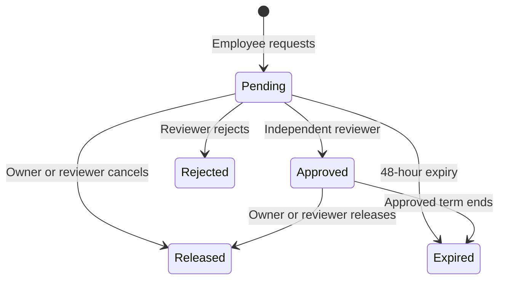

# Approval, employee activity and access

## Role matrix

| Capability | Sales | Staff | Manager | Admin |
| --- | --- | --- | --- | --- |
| Read internal inventory, addresses, contacts/files and employee directory | Yes | Yes | Yes | Yes |
| Create property / request reservation | Yes | Yes | Yes | Yes |
| Edit property/address | Own unarchived | All unarchived | All unarchived | All unarchived |
| Correct an existing linked shared-contact detail | Yes | Yes | Yes | Yes |
| Create contacts, change relationship/primary markers or unlink | No | Yes | Yes | Yes |
| Submit correction request | Yes | Yes | Yes | Yes |
| Process/reject correction requests | No | Yes | Yes | Yes |
| Record own page view / owner-contact access | Yes | Yes | Yes | Yes |
| Read daily activity | Own | Own | All | All |
| Approve/reject lock | No | No | Another employee only | Another employee only |
| Set legal/review state; sold/rented arrives with issue #32 sale transition | No | No | Yes | Yes |
| Manage employee activation/roles and catalogs | No | No | No | Yes |
| Deactivate a linked employee (guarded; provider block confirmed) | No | No | No | Yes |
| Open the admin employee list (`/people/employees`) | No | No | No | Yes |
| Read area/employee analytics | No | No | Yes | Yes |
| Read staging/audit directly through API | No | No | No | No |

These roles are company-wide. No team isolation is assumed. The directory includes work emails and employee phones; treat these as internal data.

## Reservation lifecycle

A rejected/released/expired request is terminal; a later claim is a new request. Approved is effective only while `expires_at > now()`. Pending requests are visible for review and do not reserve the property. Competing pending requests are allowed; approval serializes on the property row, then checks the partial unique index. The database forbids self approval, even for admins.

Reviewers inspect the deal reason, customer agreement evidence and claimant, then record a decision reason. The reference/evidence links are commission-attribution evidence only. Advertised sale price is not an agreed deal value or a commission basis. Selling/renting an inventory record is outside ordinary maintenance; the sold/rented transition arrives with the independent sale transition (issue #32) and does not record a payment.

Each transition writes a lock event and an audit snapshot. Expired rows are cleaned lazily when a reservation RPC operates on the same property. Dashboards always use effective locks, so expiry is correct even before cleanup. A scheduled sweeper is optional; if added, acquire the property lock first and append expiry events. Do not let a stale approved row block an approval without expiring it within the same transaction.

Deactivation disables internal membership first and confirms the exact Auth sign-in block through the server-only adapter; a failed or ambiguous provider result stays a recorded reconciliation state and never claims completed deactivation. The departing employee's outstanding reservations stay attributed to them: the control makes their existence visible, and the existing claimant or reviewer may release them or let them expire. Nothing is transferred automatically and the historical claimant is never rewritten. Existing short-lived file links remain bearer links until expiry, so the application should keep their lifetime short.

## Employee activity and daily KPIs

| Metric | Definition | Interpretation |
| --- | --- | --- |
| Page view events | Every logged detail-open event | Interaction count; reloads can increase it |
| Distinct properties viewed | Unique property UUIDs per employee/Vietnam day | Better inventory activity measure |
| Owner-contact properties | Distinct properties whose recorded owner phone was deliberately disclosed per employee/Vietnam day | Disclosure count; not calls, owners or physical visits |

Legacy `clicks` is imported as `page_view`/`legacy_click`. It never becomes `site_visit` merely because the sheet contains “Ngày xem”. New events use the server time of submission, with an employee-scoped UUID retry key. Physical-visit submission and confirmation are retired; retained `site_visit` rows keep their original attribution, day and status, and the MVP still supports no backdated visits.

The daily view has rows only for days with recorded events. Reporting over a selected range crosses a Vietnam date calendar — the caller's own personal report and company admin reporting for every currently active employee — so requested days with no events appear as explicit zeros; a deactivated employee's historical events are not listed there. “Active employee” on a day means at least one tracked view or owner-contact access according to the displayed metric; it is not proof of attendance, employment hours or GPS presence.

## Rental and localization extension

The required languages are VI/EN, with Vietnamese regional conventions in either UI. Staff/managers/admin maintain rental drafts and payment submissions. Manager/admin independently activate leases and confirm/reject/void another employee's receipt/refund. Sales can view tenancy/occupancy status but not rental payment details. Monthly dues, paid balance and overdue/refund states are derived from confirmed payments. See `rental-localization-contract.md`. Commission payout remains outside scope.

## Database and file security

- RLS and explicit grants apply together to exposed tables. `anon` has no inventory access.
- Authorization uses a live active employee row, independent of editable Auth profile metadata.
- Business mutation definers are private, fixed-search-path functions with explicit role checks; public endpoints are invoker wrappers.
- Views are invoker views; private staging and audit tables have RLS and no client grants.
- Legal/photos bucket is private. Only registered pending uploads are accepted; ready objects are readable only by active employees under policy.
- Browser file overwrites and deletion are denied. Upload completion checks object presence and document review is reviewer-only.
- UI hidden controls improve usability; database policies remain the authority.

## Operational controls to implement

Validate every form and server input. Require POST/Server Action mutations with origin/CSRF protections appropriate to the route. Limit high-volume search/event submissions in application middleware or an equivalent rate limiter. Prevent shared caching of signed-in data. Keep logs limited to request IDs, error classes and safe identifiers. Alert on repeated reservation conflicts or failed file completions without logging deal/contact content.

Admin user invitations must link the correct Auth account to an employee email and confirm the requested role. The last active admin is protected by a database trigger that refuses a deactivation, demotion, unlink or removal that would leave the company without an active admin, serialized with an advisory lock so concurrent removals cannot both pass; deactivation runs through the guarded `begin_employee_deactivation` RPC and a direct lifecycle, link or role write cannot bypass the guard. Activation, invitation and role-change forms remain unshipped. Bootstrap the first admin through a controlled administrative database action after creating the Auth account.
