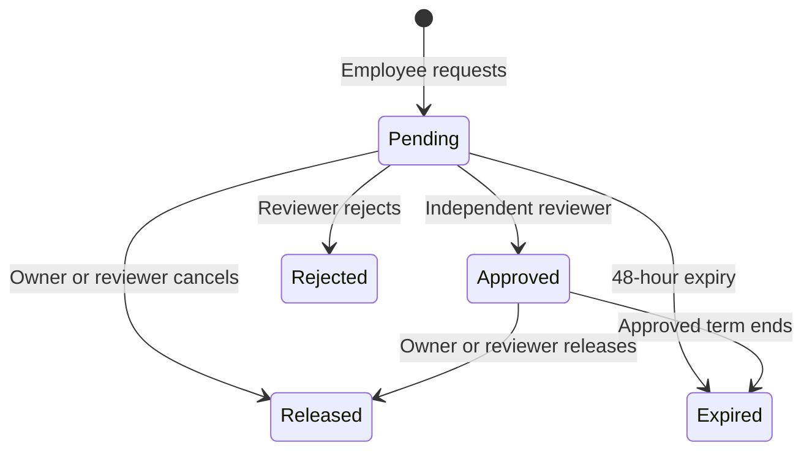

# Approval, employee activity and access

## Role matrix

| Capability | Sales | Staff | Manager | Admin |
| --- | --- | --- | --- | --- |
| Read internal inventory, addresses, contacts/files and employee directory | Yes | Yes | Yes | Yes |
| Create property / request reservation | Yes | Yes | Yes | Yes |
| Edit property/address | Own unarchived | All unarchived | All unarchived | All unarchived |
| Maintain contact records | No | Yes | Yes | Yes |
| Record own page view / visit | Yes | Yes | Yes | Yes |
| Read daily activity | Own | Own | All | All |
| Approve/reject lock or confirm visit | No | No | Another employee only | Another employee only |
| Set legal/review/sold/rented state | No | No | Yes | Yes |
| Manage employee activation/roles and catalogs | No | No | No | Yes |
| Read area/employee analytics | No | No | Yes | Yes |
| Read staging/audit directly through API | No | No | No | No |

These roles are company-wide. No team isolation is assumed. The directory includes work emails and employee phones; treat these as internal data.

## Reservation lifecycle

A rejected/released/expired request is terminal; a later claim is a new request. Approved is effective only while `expires_at > now()`. Pending requests are visible for review and do not reserve the property. Competing pending requests are allowed; approval serializes on the property row, then checks the partial unique index. The database forbids self approval, even for admins.

Reviewers inspect the deal reason, customer agreement evidence and claimant, then record a decision reason. The reference/evidence links are commission-attribution evidence only. Advertised sale price is not an agreed deal value or a commission basis. Selling/renting an inventory record is a separate manager/admin action; it does not record a payment.

Each transition writes a lock event and an audit snapshot. Expired rows are cleaned lazily when a reservation RPC operates on the same property. Dashboards always use effective locks, so expiry is correct even before cleanup. A scheduled sweeper is optional; if added, acquire the property lock first and append expiry events. Do not let a stale approved row block an approval without expiring it within the same transaction.

Deactivation is immediate for subsequent RLS/RPC requests. Review the departing employee's reservations, then release/reassign through new approved requests as appropriate. Do not rewrite the historical claimant to make reports look cleaner. Existing short-lived file links remain bearer links until expiry, so the application should keep their lifetime short.

## Employee activity and daily KPIs

| Metric | Definition | Interpretation |
| --- | --- | --- |
| Page view events | Every logged detail-open event | Interaction count; reloads can increase it |
| Distinct properties viewed | Unique property UUIDs per employee/Vietnam day | Better inventory activity measure |
| Pending site visits | Submitted site visits awaiting independent confirmation | Claims, not completed KPI |
| Confirmed properties visited | Distinct confirmed site-visit property UUIDs per employee/Vietnam day | Physical visit KPI for the MVP |

Legacy `clicks` is imported as `page_view`/`legacy_click`. It never becomes `site_visit` merely because the sheet contains “Ngày xem”. New events use the server time of submission, with an employee-scoped UUID retry key. The MVP does not support backdated visits; if needed later, distinguish occurred time from submission time and implement review controls.

The daily view has rows only for days with recorded events. Admin reporting must left-join a Vietnam date calendar and employees to show zero-activity days. “Active employee” on a day means at least one tracked view or confirmed visit according to the displayed metric; it is not proof of attendance, employment hours or GPS presence.

## Rental and localization extension

The required languages are VI/EN, with Vietnamese regional conventions in either UI. Staff/managers/admin maintain rental drafts and payment submissions. Manager/admin independently activate leases and confirm/reject/void another employee's receipt/refund. Sales can view tenancy/occupancy status but not rental payment details. Monthly dues, paid balance and overdue/refund states are derived from confirmed payments. See `rental-localization-contract.md`. Commission payout remains outside scope.

## Database and file security

- RLS and explicit grants apply together to exposed tables. `anon` has no inventory access.
- Authorization uses a live active employee row, independent of editable Auth profile metadata.
- Business mutation definers are private, fixed-search-path functions with explicit role checks; public endpoints are invoker wrappers.
- Views are invoker views; private staging and audit tables have RLS and no client grants.
- Legal/photos bucket is private. Only registered pending uploads are accepted; ready objects are readable only by active employees under policy.
- Browser file overwrites and deletion are denied. Upload completion checks object presence and document review is reviewer-only.
- UI hidden controls improve usability; database policies remain the authority.

## Operational controls to implement

Validate every form and server input. Require POST/Server Action mutations with origin/CSRF protections appropriate to the route. Limit high-volume search/event submissions in application middleware or an equivalent rate limiter. Prevent shared caching of signed-in data. Keep logs limited to request IDs, error classes and safe identifiers. Alert on repeated reservation conflicts or failed file completions without logging deal/contact content.

Admin user invitations must link the correct Auth account to an employee email, confirm the requested role and prevent unintentional lockout of the last active admin. The schema does not yet enforce a last-admin invariant; implement a guarded administrative RPC before exposing activation/role forms. Bootstrap the first admin through a controlled administrative database action after creating the Auth account.
